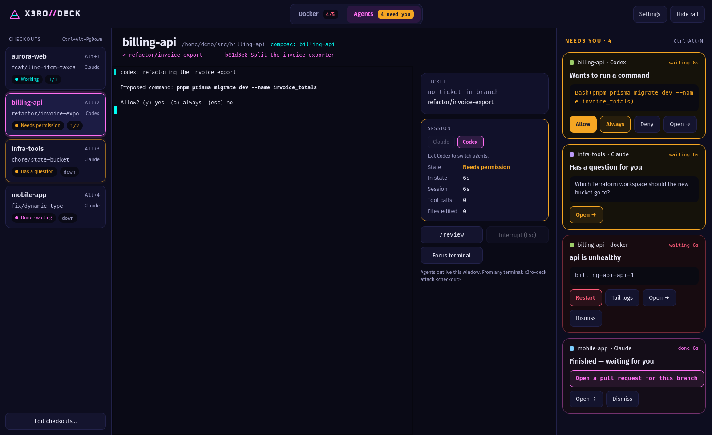
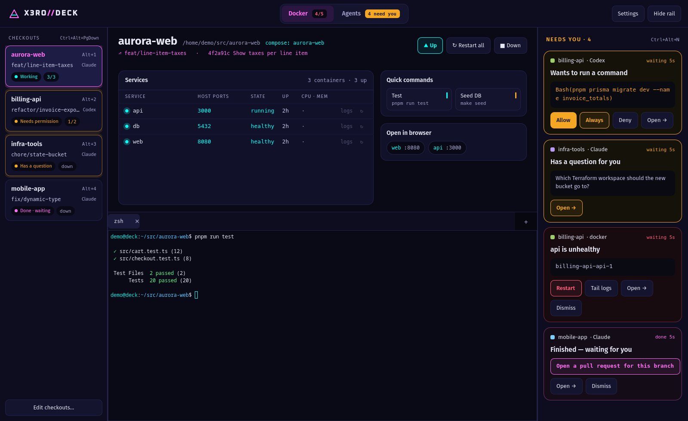

# x3ro deck

A desktop cockpit for coding agents. Run Claude Code, Codex or any CLI agent in
each of your checkouts, see at a glance which one needs you, answer permission
prompts without hunting for the right terminal, and keep each checkout's Docker
Compose stack, quick commands and pull request in view.



- **Agents that outlive the window.** Each checkout's agent runs in a tmux
  session or in the bundled session daemon, so closing x3ro deck never stops
  an agent. Attach from any terminal with `x3ro-deck attach <checkout>`.
- **NEEDS YOU.** Permission prompts, questions, finished turns and unhealthy
  containers collect in one rail, with Allow/Deny right there, desktop
  notifications and a tray badge.
- **Docker per checkout.** Up, down and restart with the right compose files,
  profiles and project name, live container health, logs, and browser links
  for every web port, including dev servers started in the checkout.
- **Quick commands found for you** in Makefiles, package.json, justfiles,
  Taskfiles, mise, Cargo, Go, Deno, pyproject, tox, nox, Composer, Rake, Gradle
  and Maven.
- **Your terminal's look.** The built-in terminal imports colors, font and
  shell from Konsole, kitty, Ghostty, Alacritty, GNOME Terminal, Ptyxis,
  xfce4-terminal, COSMIC, iTerm2, Terminal.app, Windows Terminal and more.
- Themes with a light/dark System mode and an editor, rebindable shortcuts, a
  global show/hide hotkey, and the pull request's checks and reviews per
  branch.



## Install

| OS | How |
|---|---|
| Arch Linux, Debian, Ubuntu, Fedora, openSUSE | the signed pacman/apt/dnf/zypper repository; `install.sh` below sets it up |
| macOS 12+ | the DMG from the [releases page](https://github.com/djhype/x3ro-deck/releases) (unsigned, see below) |
| Windows 10/11 | the installer from the [releases page](https://github.com/djhype/x3ro-deck/releases) (unsigned, see below) |

The macOS and Windows builds are not code-signed yet, so the first launch
needs one extra step:

- **macOS** refuses to open the app the first time. Open System Settings →
  Privacy & Security and choose **Open Anyway**, or run
  `xattr -dr com.apple.quarantine /Applications/x3ro-deck.app`.
- **Windows** SmartScreen warns about an unknown publisher. Choose **More
  info → Run anyway**.

Compare the download with `SHA256SUMS` on the releases page first.

The install script picks your package manager and adds the signed repository.
Read it before running it:

```sh
curl -fsSLO https://deck.x3ro.life/install.sh
less install.sh            # check what it does
sh install.sh
```

On Windows the same is `install.ps1`:

```powershell
Invoke-WebRequest https://deck.x3ro.life/install.ps1 -OutFile install.ps1
notepad install.ps1        # check what it does
powershell -ExecutionPolicy Bypass -File install.ps1
```

You also need the agents you want to run (`npm install -g
@anthropic-ai/claude-code`, `npm install -g @openai/codex`), git, and
optionally Docker with the compose plugin, tmux (Linux and macOS) and the
GitHub CLI (`gh auth login`) for pull request status. Settings → General →
Dependencies shows what's missing and how to install it.

## First run

1. Start x3ro deck. The welcome screen asks for a repository folder and lists
   its git worktrees; pick the ones to add as checkouts.
2. Open **Settings → Agents** and press **Install** next to Claude Code and
   Codex. This registers `x3ro-deck-hook`, which tells x3ro deck what each
   agent is doing. Other hooks in those files are left alone, and a `.bak`
   copy is kept.
3. **Codex only:** start Codex once and type `/hooks` to trust the new hook.
   Codex ignores hooks until you do.
4. Select a checkout and press **Start**.

### Hooks by hand

If you'd rather edit the files yourself, add an entry like this for each
event to `~/.claude/settings.json` (Claude Code) or `~/.codex/hooks.json`
(Codex), with the absolute path of `x3ro-deck-hook`:

```json
{
  "hooks": {
    "PermissionRequest": [
      { "hooks": [{ "type": "command", "command": "/usr/local/bin/x3ro-deck-hook", "timeout": 5 }] }
    ]
  }
}
```

Claude Code events: `SessionStart`, `UserPromptSubmit`, `PreToolUse`,
`PermissionRequest`, `PostToolUse`, `PostToolUseFailure`, `Notification`
(matcher `permission_prompt|idle_prompt|elicitation_dialog`), `Stop`,
`SessionEnd`. Codex events: the same without `Notification` and
`PostToolUseFailure`, plus `Interrupt`.

## Configuration

Everything lives in `config.json`, which Settings edits for you:
`~/.config/x3ro-deck/` on Linux, `~/Library/Preferences/x3ro-deck/` on macOS
and `%LOCALAPPDATA%\x3ro-deck\` on Windows. Keys you leave out keep their
defaults, and older files are migrated automatically (with a backup).

| Key | What it does |
|---|---|
| `configVersion` | The file's layout version; managed by the app. |
| `checkouts` | The checkouts, in rail order (see below). |
| `agents` | Agent profiles (see below). |
| `defaultAgent` | Profile id for checkouts that don't name one. |
| `autostartAgents` | Start the agent when a checkout's session is created (default `true`). |
| `notifyOnDone` | Notify when an agent finishes a turn (default `true`). |
| `sessionBackend` | `tmux` or `daemon` (default: `tmux` when installed). |
| `dockerHost` | Docker endpoint; empty finds it (`DOCKER_HOST`, the docker context, rootless Docker, Podman, Colima, OrbStack, Docker Desktop). |
| `composeBinary` | What `{compose}` becomes: `docker compose`, `docker-compose` or `podman compose`. |
| `quickCommands` | Your own quick commands for every checkout: `label`, `command`, `group` (`check`, `env`, `data` or any name). |
| `links` | Named browser links: `label`, `service`, `containerPort`. Web ports also get links by themselves. |
| `terminalSettings` | Terminal to import the look from: empty for the desktop's default, `none`, or an id such as `kitty`. |
| `terminalProfile` | That terminal's profile; empty for its default. |
| `terminalScrollback` | History lines when the imported profile sets none (default 10000). |
| `theme` | `cyberdecker`, `cyberdecker-light`, `system`, or a file name from the `themes/` folder. |
| `themeLight`, `themeDark` | What `system` shows in light and dark mode. |
| `windowsShell` | Windows: `pwsh`, `powershell`, `cmd` or `bash` (Git Bash); empty picks PowerShell 7. |
| `shortcuts` | Rebound shortcuts by id, for example `{"next-checkout": "Ctrl+Alt+J"}`; `""` unbinds one. |

A **checkout** has `name`, `path`, `agent` (a profile id), `args` (extra flags
for the agent's command line), `quickCommands` (its own, shown with the global
ones; one with a global command's label replaces it) and `compose`, an object
with `up`, `down`, `restart` (custom commands), `files` (passed with `-f`, in
order), `profiles`, `envFile` and `project`.

An **agent profile** has `id`, `label`, `kind` (`claude`, `codex` or
`custom`), `command`, `continueArgs` (what Continue adds), `process` (the
process name that means the agent is running), `env` (variables set on the
session), `permissionKeys` (`allow`, `always`, `deny`: the keys the buttons
send), `prPrompt`, `prompts` (one button each) and `submitDelayMs`.

### A local model

Point Claude Code at any Anthropic-compatible server through a profile's
`env`. Keep `ANTHROPIC_AUTH_TOKEN` set, or Claude Code sends your claude.ai
login to that server:

```json
{
  "id": "local",
  "label": "Local model",
  "kind": "claude",
  "env": {
    "ANTHROPIC_BASE_URL": "http://localhost:8080",
    "ANTHROPIC_AUTH_TOKEN": "local",
    "ANTHROPIC_MODEL": "my-model",
    "ANTHROPIC_DEFAULT_OPUS_MODEL": "my-model",
    "ANTHROPIC_DEFAULT_SONNET_MODEL": "my-model",
    "ANTHROPIC_DEFAULT_HAIKU_MODEL": "my-model"
  }
}
```

## Troubleshooting

- **The agent's state never changes.** The hook isn't registered, or (Codex)
  not trusted. Check Settings → Agents, and run `/hooks` in Codex. The session
  panel also warns when a running agent sends no hook events.
- **"The session daemon is required."** The daemon backend is selected but
  `x3ro-deck-sessiond` wasn't found next to the app. Reinstall, or switch to
  tmux in Settings → General → Sessions.
- **No pull request status.** Install the GitHub CLI and run `gh auth login`;
  the session panel says which one is missing. Repositories without a GitHub
  remote show "No GitHub remote".
- **The Docker panel stays empty.** Settings → Docker shows which socket is in
  use. Containers belong to a checkout when compose started them in its folder,
  or when the checkout names their project.
- **No notifications on macOS.** Unsigned builds can't use the notification
  center; they show plain messages from the menu bar icon instead.
- **No toasts on Windows.** Toasts need the Start menu shortcut the installer
  creates; x3ro deck makes one itself on first run.
- **Logs.** Start x3ro deck from a terminal with `QT_FORCE_STDERR_LOGGING=1`.

## Building from source

```sh
cmake --preset linux        # or macos / windows
cmake --build --preset linux
ctest --test-dir build
```

`CONTRIBUTING.md` lists the dependencies for each OS and the checks to run
before sending a change. `x3ro-deck --demo` shows made-up checkouts, which is
how the screenshots above were taken.

## License

x3ro deck is free software under the GNU General Public License, version 3 or
later, with additional terms: modified versions keep the "x3ro deck by x3ro"
credit, and the name and logo are reserved (see `LICENSE` and
`TRADEMARKS.md`). It uses Qt (LGPL-3.0) and libvterm (MIT).
